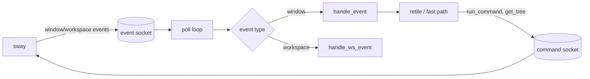

# sway-mstack architecture

This document describes the daemon's internals: the state model, the
event pipeline, the fast paths, and the test system. It is aimed at
maintainers, not only at users.

- [Русская версия](ARCHITECTURE_ru.md)
- [README](README.md)

---

## 1. Purpose and constraints

`sway-mstack` is a master/stack layout daemon for Sway. It does not
patch the compositor and does not add key bindings: everything goes
through the stock Sway IPC (`$SWAYSOCK`), and the layout is a pure
function of window order in the tree.

The workspace invariant is exactly two zones:

```text
splith {
    master _m<ws>          (MASTER_PCT%)
    splitv stack _s<ws>    (the remaining windows, top to bottom)
}
```

For n=2 the stack container is omitted: the master and the stack window
are direct siblings under `splith`. Otherwise `move right` on the master
pulls it into the singleton wrapper and the workspace collapses into a
full-screen `splitv` for a frame; flat siblings give a native horizontal
swap in both directions. From n=3 the regular `splitv` stack applies.

The architecture grew out of a few hard constraints:

- **No transactions.** Sway applies each IPC command separately; an
  intermediate state may reach a frame. The daemon therefore sends the
  canonical batch as a single `run_command` and avoids reading the
  tree when the order is already known.
- **No spawn hook.** The `window::new` event arrives before
  `for_window` rules are applied, so "tiled or floating" has to be
  decided from the events that follow.
- **Marks are global.** `mark --add` steals the mark from its previous
  holder but leaves the window's other marks alone. This lets the
  daemon keep state directly in Sway's tree.
- **Single thread.** The daemon is single-threaded: `poll()` on the
  event socket plus synchronous requests/commands on a second socket.
  The only lock is the `flock` that prevents a second instance.

The daemon does not manage floating windows (it only centers them when
they are created or return to tiling), does not manage scratchpad
contents, and does not intercept manual resizes: the master share is
fixed at startup (`sway-mstack N`, N = 10..90). A `floating` event also
retiles every workspace: by the time it arrives, a master moved to the
scratchpad is already outside the normal workspaces, so a targeted
retile by `con_id` cannot find it.

---

## 2. Process and connections



At startup the daemon:

1. parses the optional `N` argument (master share);
2. takes a `flock` on `$XDG_RUNTIME_DIR/sms.lock` (or
   `/tmp/sms-<uid>.lock`) so that a second instance cannot start;
3. opens **two** UNIX sockets: one for event subscription and one for
   commands;
4. subscribes to `window` and `workspace`;
5. reads the tree, records the focused workspace/window, and performs
   the initial `retile_all`.

After that the `poll()` loop runs: parse an `i3-ipc` frame, dispatch it
to a handler. Commands and tree requests go through the second socket
so that event traffic is never mixed with replies. `poll()` has a
`WATCHDOG_MS` timeout (100 ms) that runs the center-swap watchdog
(section 4.5), so an idle daemon wakes up ten times per second.

Shutdown is driven by `SIGTERM`/`SIGINT`: a `g_stop` flag, a clean exit
from `poll()`, releasing the pending event queue, and closing the
sockets. The daemon installs nothing in the user's config, so there is
nothing to remove on exit.

---

## 3. State

### 3.1. Marks in the tree

| Mark | Meaning |
| --- | --- |
| `_m<wsid>` | master of workspace `wsid` |
| `_s<wsid>` | stack anchor: its top window |
| `_p<wsid>` | return partner: the window that `move right` brings back to master |
| `_a<wsid>` | temporary anchor used while reordering the stack |

The state lives in Sway itself and survives a daemon restart. Marks are
addressed with `[con_id=…]` or `[con_mark=…]`; "blind" batches add a
`workspace="^name$"` guard so that a command cannot touch a window that
has moved to another workspace.

### 3.2. Workspace snapshots

`Snap` is the last **healthy** order of a workspace: master, partner,
stack list top-to-bottom, and the workspace name. The cache holds 16
workspaces and evicts by **read** LRU. A snapshot:

- is refreshed after a retile that sent no commands;
- is invalidated by any structural command (`move`, `swap`, `split`,
  `layout`) but survives mark-only batches, `resize`, and `focus`;
- is used to accelerate blind spawn, blind master death, and exact
  zoom.

A snapshot is not a source of truth. If it is missing, the workspace
name does not fit into `WSNAME_MAX` (96 bytes), or the name cannot be
escaped, the daemon takes the "honest" path: `get_tree` → `retile`.
Behavior is identical, just one frame slower.

### 3.3. Echo cache

Every move command sent by the daemon produces exactly one
`window::move` event (swap, mark, and resize produce none). The `Echo`
cache remembers window ids the daemon moved itself so that it does not
schedule a retile for its own echo.

- a normal record has a 500 ms TTL;
- a short record (throw to the adjacent output) has a 100 ms TTL;
- a short record for the focused window is not swallowed: it is most
  likely a quick user gesture;
- closing a window drops all of its records;
- a failed batch is rolled back based on `"success": false`.

### 3.4. Focus

`g_focus_ws` and `g_focus_win` are updated from `workspace::focus` and
`window::focus`. They are needed to:

- avoid stealing focus from a user who is on a stack window;
- give focus to the new master only if the dead master held it;
- keep the user on the current output when the last window closes.

When the workspace changes, `g_focus_win` is reset: "focus" on an
invisible workspace is irrelevant.

---

## 4. Event pipeline

### 4.1. `window::new`

If the window is floating, center it and return. Otherwise a verdict is
needed: tiled, or floated by a `for_window` rule.

The `new` event arrives **before** the criteria are applied, so the
window always reports `auto_off` in the event JSON. Sway is
single-threaded: it appends the events of the same `view_map`
(floating/focus) to the socket before it gets to our batch. The daemon:

1. checks the already-pending queue (`g_pend`);
2. drains the socket without blocking (`spawn_drain`);
3. waits up to 3×1 ms if necessary;
4. `floating` → leave the window alone; `close` → the regular close
   handler will deal with it; `focus` → the window is tiled;
5. silence → honest `get_tree` path (the window may have been moved to
   another workspace by a `for_window` rule).

`spawn_fast` is called only for a proven tiled spawn with a fresh
snapshot.

### 4.2. `window::close`

If a non-master died, a retile is enough. If the master died, try
`death_fast` from the snapshot first; fall back to the honest path if
the snapshot or the name is missing. Focus is handed to the new master
only when both conditions hold: the dead window held focus, and the
user is still on this workspace.

### 4.3. `window::move`

- the event matches an echo record — ignore it;
- otherwise retile; if the window carried a daemon mark, traverse
  **all** workspaces: the window may have moved to another output, and
  the old workspace is left without a master or anchor.

### 4.4. `window::floating`, `window::focus`, `workspace::focus`

`floating` centers the window when it floats, retiles when it returns to
tiling, and retiles all workspaces when a master leaves for the
scratchpad: the event does not carry the old workspace id, and the
window is already inside `__i3_scratch`. `focus` updates the window
memory. `workspace::focus` updates `g_focus_ws` and resets `g_focus_win`
when the workspace changes.

### 4.5. Center-swap watchdog

When a window is dropped on another window's center, Sway's
`finalize_move` calls `container_swap` and returns **without**
`window::move`. Focus stays on the dragged container, so there is no
`window::focus` either: the daemon receives no event at all. Sway also
copies the sibling's geometry (native 50/50), and the marks remain on
their old windows.

Every `WATCHDOG_MS` (100 ms) of `poll()` silence the daemon reads the
tree and checks the structural invariant: the `_m<ws>` holder is in
slot 0, the master is a direct child of the workspace, the workspace is
`splith`; for n=2 both windows are direct siblings, and for n>=3 a stack
container exists, sits directly under the workspace, and is not `splith`
(a row of stripes). Any drift is healed by the regular `retile_ws`: 0–3
commands (re-mark `_m`/`_s`, `split none` for a singleton wrapper,
`split vertical`, `resize 55 ppt`). A healthy workspace costs one
`GET_TREE` and zero commands; workspaces without `_m` or with a mark on a
non-slot are left alone. All workspaces are checked, so cross-workspace
swaps are covered too.

The raw `GET_TREE` reply is cached: when the next tick receives a
byte-identical JSON payload, `json_tokener_parse` is skipped, since
comparing bytes is about two orders of magnitude cheaper than parsing.
After a healing batch the cache is dropped so the next tick re-reads the
result of those commands; if drift is found but no commands could be
built, the cache is dropped too and the next tick retries the heal.
Measured with five windows: 0–10 ms of CPU per
10 s of idling in a Debug build with logging (up to ~0.1% of one core),
0 ms in Release without logs; in a workload of 280 `GET_TREE` calls, 159
replies matched and were not parsed.

---

## 5. Layout: `retile_ws`

`retile_ws` is the central function. It collects a `Tiled` structure
with a single DFS (`collect`), finds marks and parents, and then builds
a batch of commands.

Window order in the tree is visual order: master first, then the stack
top-to-bottom. For each workspace it computes:

- `n` — number of tiles;
- `master_id`, `stack_id`, `partner_id`;
- `parent[i]` — the window's container (used to distinguish a flat
  workspace from a stack);
- `rw[i]` — widths for the proportion check.

Main branches:

1. **Edge moves.** `move up` on the top window or `move down` on the
   bottom one breaks the invariant: the window escapes to workspace
   level and the workspace flips to `splitv`. The fix is a
   restructuring `[window] move left`: the window becomes the first
   child, and the workspace becomes `splith`.
2. **Zoom.** The removed master becomes the top of the stack, while the
   zoomed window inherits its place and geometry. The `_p` memory is
   placed on the removed master.
3. **Master death.** The top of the stack becomes master; if it was the
   only stack window, `move left` is not used (on a singleton it warps
   the window to the adjacent output) — `split none` is used instead to
   dissolve Sway's singleton wrapper.
4. **n=2 canon.** The stack is not wrapped in a container: the master
   and the stack window are direct siblings. A singleton wrapper is
   dissolved with `split none` (a parent with one child, so the window
   does not warp), `_s` is set, and `resize 55 ppt` is sent if needed.
   This keeps both swap directions native.
5. **Proportions.** If the master width is outside `MASTER_PCT ± 3%`,
   or a window has "escaped" its container, send
   `resize set width N ppt`.
6. **Stack (n>=3).** The `_s` anchor is placed on the first non-master;
   a flat workspace is wrapped in `split vertical`; stray windows are
   moved to the anchor.

A mark-only batch is not structural: the snapshot remains valid after
it. Any `move/swap/split/layout` command increments `g_struct_sent`,
and the caller must run `reconcile`.

---

## 6. Fast paths

### 6.1. `spawn_fast`

The goal is to beat the first frame. The snapshot knows the master and
the top of the stack, so the batch goes out **without** `get_tree`:

```text
swap the newcomer with _m
mark _m on the newcomer
remove _p (if present)
move the previous master into the stack and mark it _s
resize the newcomer to MASTER_PCT
```

Every command is guarded with `workspace="^name$"`; commands that
target the newcomer also carry `tiling` so that a window that has
already floated is not touched. After the batch, an addressed
`reconcile` runs for the newcomer's id.

Special case `n == 0` (the master was alone): after the swap the
previous master is on the right; the batch immediately sets `_s`,
`split vertical`, and the proportion, avoiding a second frame.

### 6.2. `death_fast`

The snapshot knows the top of the stack and its size:

- `n >= 2`: the top gets `move left`, `_m`, and the proportion; the
  `_s` anchor moves to the next window;
- `n == 1`: the last window is **not moved** (it would warp to the
  adjacent output); only `_m`, removal of `_s`, and `split none` are
  issued;
- `_p` is cleared if the snapshot knows a live holder;
- focus is given only if the dead master held it and the user is on
  this workspace.

### 6.3. Exact zoom and rotation

`move left` on a stack window is a zoom. With a snapshot the order is
known, so a single swap puts the zoomed window in the master slot and
the removed master in the exact slot of the zoomed window. The `_p`
memory lets `move right` restore everything.

Without the memory, `move right` on the master is a rotation: the
neighbor becomes master and the removed master stays at the top of the
stack. The rotation installs the memory, so a second `move right`
restores the original order.

### 6.4. Multiple outputs

Before a "throw" from the stack, the daemon checks whether an output
lies noticeably to the right of the current one (`output_right_of`).
If so, the window moves there as master; if not, the usual
rotation/zoom happens inside the workspace. On return, `move left`
puts the previous master at the top of the stack.

---

## 7. Control `reconcile`

After any structural batch, the tree may be left unfinished even
without move commands (for example, a single `split vertical` on a flat
`n == 2`, or `layout splith` out of tabbed). Therefore:

1. `retile_all` walks every workspace (or one addressed workspace);
2. if structural commands were sent, `reconcile` re-reads the tree and
   repeats the retile;
3. the loop repeats until a round sends zero commands (converges in 1–2
   rounds);
4. on a healthy workspace `reconcile` sends nothing and refreshes the
   snapshots.

---

## 8. Safety and robustness

- **Single instance** — `flock` with `O_NOFOLLOW`, file mode `0600`.
- **Workspace names** are escaped for Sway criteria (`ws_guard`):
  spaces, quotes, colons, slashes, UTF-8; control bytes and a trailing
  backslash are rejected.
- **IPC length** is capped at 16 MB; an oversized payload is drained
  rather than sent.
- **Read/write** use full loops with `EINTR` handling; `SIGPIPE` is
  ignored.
- **JSON** is parsed with an exact-length parser; all accessors are
  NULL-safe.
- **Memory** uses fixed arrays for 64 tiles, 256 echo records, and 16
  snapshots; overflow degrades predictably instead of corrupting
  memory.
- **Floating windows and scratchpad contents** are not managed.

---

## 9. Build

### 9.1. Source layout

The daemon remains a **single translation unit**: `src/main.c` includes
`src/sms.h` and the `src/parts/*.inc` fragments in declaration order.
This preserves static functions, global state, and the existing unit
tests that include `src/main.c` as a whole.

| File | Contents |
| --- | --- |
| `src/main.c` | entry point, signals, include order |
| `src/sms.h` | feature macros, system includes, tuning, shared flags |
| `src/parts/ipc.inc` | POSIX I/O and Sway IPC frames |
| `src/parts/json.inc` | NULL-safe json-c accessors |
| `src/parts/layout.inc` | workspace guards, tile collection, `idx_of` |
| `src/parts/echo.inc` | echo cache for move commands |
| `src/parts/command.inc` | command building and sending |
| `src/parts/snapshot.inc` | proportions, `Act`, workspace snapshots |
| `src/parts/retile.inc` | `retile_ws`, `retile_all`, reconcile, center-swap watchdog |
| `src/parts/spawn.inc` | `spawn_fast`, `death_fast`, verdicts |
| `src/parts/events.inc` | event handlers and focus lookup |
| `src/parts/socket.inc` | socket, subscription, `sms.lock` |

The fragments are not compiled separately: CMake still builds only
`src/main.c`. The split is purely navigational — the preprocessed token
stream and the Release binary match the former monolith.

CMake 3.25+, C23, `json-c`. Release: `-O3`, LTO/IPO (when supported),
`-march=native` by default (disable with `-DSMS_NATIVE=OFF`), hardening
(`-fstack-protector-strong`, `-fstack-clash-protection`, RELRO,
BIND_NOW, FORTIFY). Debug: `-O0 -g3` plus AddressSanitizer and
UndefinedBehaviorSanitizer.

`cmake --install` installs the binary, the documentation, and the
`sway-master-stack` compatibility symlink for 2.0.x configs.

---

## 10. Tests

### Unit

`tests/unit/test_main.c` includes `src/main.c` directly with
`#define main sms_main`. This makes static functions testable without
extracting them into a separate library. There are 366 checks now.
Covered: name escaping, JSON accessors, tile collection, proportions,
snapshots, echo cache, command building, IPC framing, POSIX I/O, focus
lookup, event handling, the master invariant used by the center-swap
watchdog, and the raw-tree cache (an identical reply is not parsed, a
changed one is).

Run:

```sh
cmake --build build --target sms_unit
ctest --test-dir build --output-on-failure
```

### E2E

`tests/e2e/` starts a **private** headless Sway session per scenario:

- its own `XDG_RUNTIME_DIR`, `SWAYSOCK`, `WAYLAND_DISPLAY`;
- its own `sms.lock`;
- windows are `foot` with unique `app_id`s;
- assertions go through `swaymsg -t get_tree` and `jq`.

The live user session is never touched. Scenarios: n=1/2/3 geometry,
native n=2 swap, master death, master to scratchpad followed by a spawn,
center drop drag (requires `wlrctl`), zoom, edge moves, rotation, tabbed
stack, long names, and a second output. That is 12 scenarios / 113 checks
in total.

```sh
tests/e2e/run.sh
E2E_SKIP_MULTI=1 tests/e2e/run.sh   # without create_output
```

### All levels

`tests/run-all.sh` builds Release and Debug, runs unit and E2E in both,
checks sanitizer reports, runs layout fuzzing on several seeds
(`tests/fuzz/layout.sh`) and an informational benchmark
(`tests/bench/bench.sh`). The quick mode is `tests/run-all.sh --quick`.

### CI

GitHub Actions builds Release and Debug (ASan/UBSan), runs the unit
tests, and runs E2E in headless Sway on Ubuntu. See
`.github/workflows/ci.yml`.

---

## 11. Deliberate non-goals

- No manual resize or dynamic master share: it would break the pure
  layout function and the snapshots.
- No management of floating windows or scratchpad contents.
- No ARM-specific optimizations; `-march=native` can be disabled.
- No attempt to smooth vanilla Sway flicker: IPC has no animation
  layer; use SwayFX for that.
