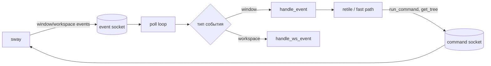

# Архитектура sway-mstack

Документ описывает внутреннее устройство демона: модель состояния,
конвейер событий, быстрые пути и систему тестов. Он рассчитан на тех,
кто сопровождает код, а не только запускает его.

- [English version](ARCHITECTURE_en.md)
- [README](README.md)

---

## 1. Назначение и ограничения

`sway-mstack` — демон раскладки master/stack для Sway. Он не патчит
композитор и не добавляет биндов: вся работа идёт через штатный Sway
IPC (`$SWAYSOCK`), а раскладка является чистой функцией порядка окон в
дереве.

Инвариант воркспейса — ровно две зоны:

```text
splith {
    мастер _m<ws>   (MASTER_PCT%)
    splitv-стопка _s<ws> (остальные окна, сверху вниз)
}
```

Ключевые ограничения, из которых выросла вся архитектура:

- **Нет транзакций.** Sway применяет каждую IPC-команду отдельно;
  промежуточное состояние может попасть в кадр. Поэтому демон старается
  отправлять каноническую пачку одной командой `run_command` и не
  читать дерево там, где порядок уже известен.
- **Нет хуков на спавн.** Событие `window::new` приходит до применения
  `for_window`-правил. Решение «тайловое или плавающее» приходится
  принимать по последующим событиям.
- **Метки глобальны.** `mark --add` крадёт метку у прежнего держателя,
  но не трогает остальные метки окна. Это позволяет хранить состояние
  прямо в дереве Sway.
- **Один поток.** Демон однопоточный: `poll()` на сокете событий и
  синхронные запросы/команды на втором сокете. Никаких блокировок,
  кроме `flock` от второго экземпляра.

Демон не управляет плавающими окнами (только центрирует их при
рождении/уходе из тайлинга), не трогает scratchpad и не перехватывает
ручной ресайз: доля мастера фиксируется при запуске (`sway-mstack N`,
N = 10..90).

---

## 2. Процесс и соединения



При старте демон:

1. разбирает необязательный аргумент `N` (доля мастера);
2. берёт `flock` на `$XDG_RUNTIME_DIR/sms.lock` (или
   `/tmp/sms-<uid>.lock`), чтобы не запуститься дважды;
3. открывает **два** UNIX-сокета: подписку на события и канал команд;
4. подписывается на `window` и `workspace`;
5. читает дерево, запоминает сфокусированные workspace/окно и делает
   первый `retile_all`.

Дальше работает цикл `poll()` → разбор кадра `i3-ipc` → обработчик.
Команды и запросы дерева идут через второй сокет, чтобы не смешивать
поток событий с ответами.

Завершение — по `SIGTERM`/`SIGINT`: флаг `g_stop`, аккуратный выход из
`poll()`, освобождение очереди отложенных событий и закрытие сокетов.
Демон ничего не устанавливает в конфиге пользователя, поэтому снимать
при выходе нечего.

---

## 3. Состояние

### 3.1. Метки в дереве

| Метка | Смысл |
| --- | --- |
| `_m<wsid>` | мастер воркспейса `wsid` |
| `_s<wsid>` | якорь стопки: её верхнее окно |
| `_p<wsid>` | партнёр возврата: окно, которое вернётся в мастер по `move right` |
| `_a<wsid>` | временный якорь перестановки внутри стопки |

Состояние живёт в самом Sway и переживает рестарт демона. Метки
адресуются командами `[con_id=…]` или `[con_mark=…]`; для «слепых»
пачек добавляется гвард `workspace="^имя$"`, чтобы команда не задела
окно, уехавшее на другой стол.

### 3.2. Снимки воркспейсов

`Snap` — последний **здоровый** порядок стола: мастер, партнёр, список
стопки сверху вниз и имя воркспейса. Кэш на 16 столов, вытеснение по
LRU **чтений**. Снимок:

- обновляется после ретайла, не отправившего ни одной команды;
- гасится любой структурной командой (`move`, `swap`, `split`,
  `layout`), но переживает чисто меточные пачки, `resize` и `focus`;
- используется как ускоритель слепого спавна, слепой смерти мастера и
  точного зума.

Снимок — не источник истины. Если его нет, имя воркспейса не влезает в
`WSNAME_MAX` (96 байт) или не экранируется, демон идёт «честным»
путём: `get_tree` → `retile`. Поведение то же, просто на кадр медленнее.

### 3.3. Кэш эха

Каждая move-команда демона порождает ровно одно `window::move` (swap,
mark и resize — ноль). Кэш `Echo` помнит id окон, которые двигал сам
демон, чтобы не запускать ретайл на собственное эхо.

- обычная запись — TTL 500 мс;
- короткая (переброс на соседний выход) — TTL 100 мс;
- запись под фокусом с коротким TTL не глотается: это, скорее всего,
  быстрый жест пользователя;
- `close` окна гасит все его записи;
- неудачная пачка откатывается по `"success": false`.

### 3.4. Фокус

`g_focus_ws` и `g_focus_win` обновляются по `workspace::focus` и
`window::focus`. Они нужны, чтобы:

- не красть фокус у пользователя, сидящего на окне стопки;
- отдавать фокус новому мастеру только если умерший мастер его держал;
- не уводить пользователя на другой выход при смерти последнего окна.

При смене воркспейса `g_focus_win` сбрасывается: «фокус» на невидимом
столе неактуален.

---

## 4. Конвейер событий

### 4.1. `window::new`

Если окно плавающее — центрирование и выход. Иначе нужен вердикт:
тайловое оно или стало плавающим по `for_window`.

Событие `new` приходит **до** критериев, поэтому в JSON окно всегда
`auto_off`. Sway однопоточен: он дописывает события того же `view_map`
(floating/focus) в сокет раньше, чем берётся за нашу пачку. Демон:

1. смотрит уже отложенную очередь (`g_pend`);
2. неблокирующе вычитывает сокет (`spawn_drain`);
3. при необходимости ждёт до 3×1 мс;
4. `floating` → не трогает окно; `close` → смерть разберёт штатный
   обработчик; `focus` → окно тайловое;
5. тишина → честный путь `get_tree` (окно могло уехать на другой стол
   по `for_window`-правилу).

Только при доказанном тайловом спавне и свежем снимке вызывается
`spawn_fast`.

### 4.2. `window::close`

Если умер не мастер — достаточно ретайла. Если мастер — сначала
`death_fast` по снимку; при отсутствии снимка или имени — честный путь.
Фокус передаётся новому мастеру только при выполнении обоих условий:
умерший держал фокус и пользователь всё ещё на этом столе.

### 4.3. `window::move`

- событие совпало с эхом — игнор;
- иначе ретайл; если на окне была демонская метка, обходятся **все**
  столы: окно могло уехать на другой выход, и старый стол остался без
  мастера или якоря.

### 4.4. `window::floating`, `window::focus`, `workspace::focus`

`floating` — центрирование при всплытии и ретайл при возврате в
тайлинг. `focus` обновляет память окна. `workspace::focus` обновляет
`g_focus_ws` и сбрасывает `g_focus_win` при смене стола.

---

## 5. Раскладка: `retile_ws`

`retile_ws` — центральная функция. Она собирает `Tiled` одним DFS
(`collect`), находит метки и родителей, затем строит пачку команд.

Порядок окон в дереве — визуальный порядок: мастер, затем стопка
сверху вниз. Для каждого стола вычисляются:

- `n` — число тайлов;
- `master_id`, `stack_id`, `partner_id`;
- `parent[i]` — контейнер окна (нужен, чтобы отличить плоский стол от
  стопки);
- `rw[i]` — ширины для контроля пропорций.

Основные ветки:

1. **Крайние движения.** `move up` на верхнем или `move down` на
   нижнем окне ломает инвариант: окно вырывается на уровень
   воркспейса, а сам воркспейс переворачивается в `splitv`. Лечение —
   реструктуризация `[окно] move left`: окно становится первым
   ребёнком, воркспейс — `splith`.
2. **Зум.** Снятый мастер становится вершиной стопки, а зумированное
   окно наследует его место и геометрию. Память `_p` ставится на
   снятого мастера.
3. **Смерть мастера.** Вершина стопки выходит в мастер; если она была
   единственным окном стопки, `move left` не используется (на
   синглтоне это уводит окно на соседний выход) — вместо него
   `split none`, распускающий singleton-обёртку Sway.
4. **Пропорции.** Если ширина мастера вне `MASTER_PCT ± 3%` или окно
   «сбежало» из контейнера, отправляется `resize set width N ppt`.
5. **Стопка.** Якорь `_s` ставится на первый не-мастер; плоский стол
   оборачивается в `split vertical`; блудные окна съезжаются к якорю.

Чисто меточная пачка не считается структурной: снимок после неё
остаётся верным. Любая команда `move/swap/split/layout` увеличивает
`g_struct_sent`, и вызывающий путь обязан прогнать `reconcile`.

---

## 6. Быстрые пути

### 6.1. `spawn_fast`

Цель — успеть до первого кадра. По снимку известны мастер и вершина
стопки, поэтому пачка уходит **без** `get_tree`:

```text
swap новичка с _m
mark _m на новичка
снять _p (если был)
сдвинуть прежнего мастера в стопку и пометить _s
resize новичка в MASTER_PCT
```

Каждая команда снабжена гвардом `workspace="^имя$"`; команды над
новичком — ещё и `tiling`, чтобы не задеть окно, которое успело
всплыть. После пачки — адресный `reconcile` по id новичка.

Особый случай `n == 0` (был только мастер): после swap прежний мастер
оказывается справа; пачка сразу ставит `_s`, `split vertical` и
пропорцию, чтобы не тратить второй кадр.

### 6.2. `death_fast`

По снимку известна вершина стопки и её размер:

- `n >= 2`: вершина получает `move left`, `_m`, пропорцию; якорь `_s`
  переезжает на следующее окно;
- `n == 1`: последнее окно **не двигается** (варп на соседний выход),
  ставятся только `_m`, снятие `_s` и `split none`;
- память `_p` гасится, если снимок знает живого держателя;
- фокус — только если умерший мастер его держал и пользователь на
  этом столе.

### 6.3. Точный зум и ротация

`move left` на окне стопки — зум. При наличии снимка порядок известен,
и один swap ставит зумированное окно на место мастера, а снятого — на
точный слот зумированного. Память `_p` позволяет `move right` вернуть
всё обратно.

Если памяти нет, `move right` на мастере — ротация: сосед выходит в
мастер, снятый остаётся вершиной стопки. Ротация ставит память, поэтому
повторный `move right` возвращает исходный порядок.

### 6.4. Мультимонитор

Перед «перебросом» из стопки проверяется, есть ли выход заметно правее
текущего (`output_right_of`). Если есть — окно уезжает на него
мастером; если нет — обычная ротация/зум внутри стола. При возврате
`move left` прежний мастер уходит наверх стопки.

---

## 7. Контрольный `reconcile`

После любой структурной пачки дерево могло остаться недоделанным даже
без move-команд (например, один `split vertical` на плоском `n == 2`
или `layout splith` из tabbed). Поэтому:

1. `retile_all` обходит все воркспейсы (или один адресный);
2. если были отправлены структурные команды — `reconcile` читает
   дерево заново и повторяет ретайл;
3. цикл повторяется, пока раунд не отправит ноль команд (сходится за
   1–2 раунда);
4. на здоровом столе `reconcile` не отправляет ничего и засевает
   снимки.

---

## 8. Безопасность и устойчивость

- **Один экземпляр** — `flock` с `O_NOFOLLOW`, файл `0600`.
- **Имена воркспейсов** экранируются для критериев Sway (`ws_guard`):
  пробелы, кавычки, двоеточия, слеши, UTF-8; контрольные байты и
  хвостовой бэкслэш отвергаются.
- **Длина IPC** ограничена 16 МБ; слишком длинный payload дренируется,
  а не отправляется.
- **Чтение/запись** — полные циклы с обработкой `EINTR`; `SIGPIPE`
  игнорируется.
- **JSON** разбирается точным парсером по известной длине; все
  доступоры NULL-безопасны.
- **Память** — фиксированные массивы на 64 тайла, 256 записей эха и 16
  снимков; переполнение не разъезжается, а деградирует предсказуемо.
- **Плавающие окна и scratchpad** не управляются.

---

## 9. Сборка

### 9.1. Структура исходников

Демон остаётся **одним translation unit**: `src/main.c` включает
`src/sms.h` и фрагменты `src/parts/*.inc` в порядке объявлений. Это
сохраняет статические функции, глобальное состояние и существующие
unit-тесты, которые включают `src/main.c` целиком.

| Файл | Содержимое |
| --- | --- |
| `src/main.c` | точка входа, сигналы, порядок включения частей |
| `src/sms.h` | feature-макросы, системные include, тюнинг, общие флаги |
| `src/parts/ipc.inc` | POSIX I/O и кадры Sway IPC |
| `src/parts/json.inc` | NULL-безопасные доступоры json-c |
| `src/parts/layout.inc` | гварды воркспейса, сбор тайлов, `idx_of` |
| `src/parts/echo.inc` | кэш эха move-команд |
| `src/parts/command.inc` | сборка и отправка команд |
| `src/parts/snapshot.inc` | пропорции, `Act`, снимки столов |
| `src/parts/retile.inc` | `retile_ws`, `retile_all`, reconcile |
| `src/parts/spawn.inc` | `spawn_fast`, `death_fast`, вердикты |
| `src/parts/events.inc` | обработчики событий и поиск фокуса |
| `src/parts/socket.inc` | сокет, подписка, `sms.lock` |

Фрагменты не компилируются отдельно: CMake по-прежнему собирает только
`src/main.c`. Разбиение чисто навигационное — поток токенов после
препроцессора и Release-бинарник совпадают с прежним монолитом.

CMake 3.25+, C23, `json-c`. Release: `-O3`, LTO/IPO (если поддерживается),
`-march=native` по умолчанию (отключается `-DSMS_NATIVE=OFF`), харденинг
(`-fstack-protector-strong`, `-fstack-clash-protection`, RELRO, BIND_NOW,
FORTIFY). Debug: `-O0 -g3` + AddressSanitizer и UndefinedBehaviorSanitizer.

`cmake --install` ставит бинарник, документацию и совместимую ссылку
`sway-master-stack` для конфигов 2.0.x.

---

## 10. Тесты

### Unit

`tests/unit/test_main.c` включает `src/main.c` напрямую с
`#define main sms_main`. Это позволяет тестировать статические функции
без выноса их в отдельную библиотеку. Покрыты: экранирование имён,
JSON-доступоры, сбор тайлов, пропорции, снимки, кэш эха, построение
команд, IPC-фрейминг, POSIX I/O, поиск фокуса, обработка событий.

Запуск:

```sh
cmake --build build --target sms_unit
ctest --test-dir build --output-on-failure
```

### E2E

`tests/e2e/` поднимает **приватную** headless-сессию Sway на каждый
сценарий:

- свой `XDG_RUNTIME_DIR`, `SWAYSOCK`, `WAYLAND_DISPLAY`;
- свой `sms.lock`;
- окна — `foot` с уникальными `app_id`;
- проверки — через `swaymsg -t get_tree` и `jq`.

Живая сессия пользователя не затрагивается. Сценарии: геометрия n=1/2/3,
смерть мастера, зум, крайние движения, ротация, tabbed-стопка, длинные
имена, второй выход.

```sh
tests/e2e/run.sh
E2E_SKIP_MULTI=1 tests/e2e/run.sh   # без create_output
```

### CI

GitHub Actions собирает Release и Debug (ASan/UBSan), гоняет unit-тесты
и E2E в headless Sway на Ubuntu. Подробности — в
`.github/workflows/ci.yml`.

---

## 11. Что сознательно не сделано

- Нет ручного ресайза и динамической доли мастера: это ломает чистую
  функцию раскладки и снимки.
- Нет управления плавающими окнами и scratchpad.
- Нет ARM-специфичных оптимизаций; `-march=native` отключается флагом.
- Нет попыток сгладить мерцание ванильного Sway: анимаций в IPC нет,
  для плавности нужен SwayFX.
