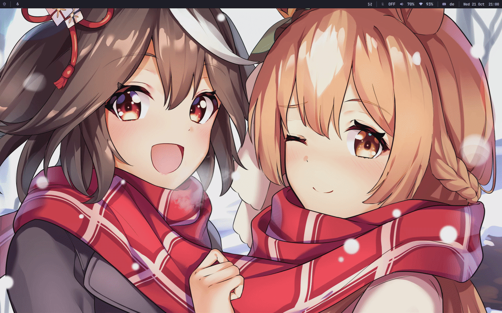

# sway-master-stack

[]()
[](https://en.wikipedia.org/wiki/C23_(C_standard_revision))
[](https://swaywm.org/)
[]()
[](LICENSE)

[English](#english) | [Русский](#русский)

---



> [!NOTE]
> The GIF shows SwayFX with animations enabled (250 ms). On vanilla Sway windows jump and flick: every layout change lands as a discrete transaction and there is no animation layer to smooth the transition. This is Sway's own design (a manual resize in plain Sway flickers the same way) and it cannot be smoothed over IPC. If this bothers you, run SwayFX.

> [!NOTE]
> Гифка показывает SwayFX с включёнными анимациями (250 мс). На ванильном Sway окна дёргаются и мерцают: каждое изменение раскладки ложится дискретной транзакцией, и нет слоя анимаций, который сгладил бы переход. Это собственный дизайн Sway (ручной ресайз в чистом Sway дёргается так же), изнутри IPC это не сгладить. Если это мешает, используйте SwayFX.

---

## English

A small DWM-style master/stack tiling daemon for [Sway](https://github.com/swaywm/sway) and [SwayFX](https://github.com/WillPower3309/swayfx). It listens to Sway events over IPC and restores the layout with a single batch of commands. Nothing to add to your Sway config. Written in ISO C23, tested on sway 1.12.

```text
+---------------------------+----------------------+
|                           |       Stack 1        |
|                           +----------------------+
|         Master            |       Stack 2        |
|                           +----------------------+
|                           |       Stack 3        |
|           55%             |         45%          |
+---------------------------+----------------------+
```

### Features

- **Master/stack layout**: the first window takes the workspace, every next one joins the stack on the right.
- **Focus zoom**: `move left` promotes a stack window to master, `move right` returns it. Standard bindings, nothing to rebind.
- **Fast response**: the batch goes out in a single `write()`, no tree round trip.
- **Tray and popups stay out**: the floating verdict is read from the socket before a new window is touched.
- **Multi-monitor safe**: windows stay on their output when the master closes.
- **Light**: ~2 MB RAM, 0% CPU idle, clean under AddressSanitizer and UndefinedBehaviorSanitizer.

### Configuration

- `sway-master-stack 60`: master share at launch, range 10 to 90. Default 55/45.
- `SMS_PCT` environment variable does the same, the command line argument wins.

### Requirements

- `clang` (>= 18, C23)
- `cmake` (>= 3.25)
- `lld`
- `json-c`
- `pkgconf`

On Arch Linux:

```sh
sudo pacman -S --needed clang lld cmake json-c pkgconf
```

### Building

```sh
git clone https://github.com/pama1232/sway-master-stack.git
cd sway-master-stack

CC=clang cmake -B build -DCMAKE_BUILD_TYPE=Release
cmake --build build

sudo cmake --install build
```

### Sway setup

Add to `~/.config/sway/config`:

```sway
exec sway-master-stack
```

Or with a custom ratio:

```sway
exec sway-master-stack 60
```

---

## Русский

Небольшой демон тайлинга master/stack в стиле DWM для [Sway](https://github.com/swaywm/sway) и [SwayFX](https://github.com/WillPower3309/swayfx). Он слушает события Sway по IPC и восстанавливает раскладку одной пачкой команд. В конфиг Sway добавлять нечего. Написан на ISO C23, протестирован на sway 1.12.

```text
+---------------------------+----------------------+
|                           |       Стопка 1       |
|                           +----------------------+
|         Мастер            |       Стопка 2       |
|                           +----------------------+
|                           |       Стопка 3       |
|           55%             |         45%          |
+---------------------------+----------------------+
```

### Возможности

- **Раскладка master/stack**: первое окно занимает весь стол, каждое следующее ложится в стопку справа.
- **Зум фокусом**: `move left` поднимает окно стопки в мастер, `move right` возвращает на место. Стандартные бинды, перевешивать не нужно.
- **Быстрый отклик**: команды уходят одним `write()`, без обхода дерева.
- **Трей и попапы не трогаются**: вердикт по плаванию вычитывается из сокета до того, как демон тронет новое окно.
- **Мультимонитор**: окна не улетают на другой выход при закрытии мастера.
- **Лёгкий**: ~2 МБ RAM, 0% CPU в простое, чист под AddressSanitizer и UndefinedBehaviorSanitizer.

### Настройка

- `sway-master-stack 60`: доля мастера при запуске, диапазон от 10 до 90. По умолчанию 55/45.
- Переменная `SMS_PCT` делает то же самое, аргумент командной строки сильнее.

### Зависимости

- `clang` (>= 18, C23)
- `cmake` (>= 3.25)
- `lld`
- `json-c`
- `pkgconf`

В Arch Linux:

```sh
sudo pacman -S --needed clang lld cmake json-c pkgconf
```

### Сборка и установка

```sh
git clone https://github.com/pama1232/sway-master-stack.git
cd sway-master-stack

CC=clang cmake -B build -DCMAKE_BUILD_TYPE=Release
cmake --build build

sudo cmake --install build
```

### Подключение в Sway

Добавьте в `~/.config/sway/config`:

```sway
exec sway-master-stack
```

Или с нужной долей мастера:

```sway
exec sway-master-stack 60
```

---

## Acknowledgements / Благодарности

- Written, debugged, and optimized with the assistance of **GLM 5.3**.
- Разработано, отлажено и оптимизировано с помощью **GLM 5.3**.

## License / Лицензия

[MIT](LICENSE) © 2026 [pama1232](https://github.com/pama1232)